

  

<h1 align="center">Dev Empire</h1>

<strong>Uma garagem, um computador e uma ideia. O próximo império do software começa com você.</strong>

  
  
  
  
  

  

  <a href="#o-jogo">O jogo</a> · <a href="#imagens-do-jogo">Imagens</a> · <a href="#como-jogar">Como jogar</a> · <a href="#sobre-o-beta">Sobre o BETA</a> · <a href="https://github.com/ithalov/dev-empire/releases">Atualizações</a>

---

## O jogo

**Dev Empire** é um simulador de gestão de empresa de software. Comece pequeno, conquiste seus primeiros clientes e decida como transformar uma equipe em uma empresa capaz de lançar seus próprios produtos.

Negocie contratos, escolha tecnologias e acompanhe cada projeto até a entrega. Conforme a empresa cresce, novos desafios entram em cena: formar talentos, manter a qualidade, enfrentar concorrentes e equilibrar as contas.

### O que você pode fazer

| Desenvolva | Gerencie | Expanda |
|---|---|---|
| Aceite e negocie contratos | Contrate e treine sua equipe | Amplie o escritório |
| Organize desenvolvimento e testes | Cuide de salários, moral e descanso | Pesquise novas tecnologias |
| Lance produtos próprios | Controle caixa, preços e investimentos | Entre em novos mercados |
| Publique melhorias e dê suporte | Reaja a eventos e decisões de negócio | Dispute espaço com concorrentes |

Jogue no seu ritmo: pause para planejar ou acelere o tempo para acompanhar os resultados das suas decisões.

## Novidades da BETA 2.23.0

- **Concorrência em movimento:** os rivais lançam aplicativos a cada dois meses, atualizam produtos, fazem campanhas, contratam e fecham parcerias. Novas empresas entram no mercado ao longo da partida.
- **Um mercado que muda:** o público cresce a cada ano e **85 acontecimentos** movimentam empresas e funcionários, com efeitos na procura, no caixa e na equipe.
- **Jornal com novidades a cada três dias:** boletins das empresas, cobertura de lançamentos e filtros para acompanhar quem você quiser.
- **Governo e economia:** 18 medidas temporárias de incentivo ou restrição, seis novas exigências fictícias de adaptação e tributos sobre receitas de produtos, com detalhamento em Finanças.
- **Reconhecimento pelo seu trabalho:** nove novas premiações anuais, incluindo Programador do Ano, Mentor do Ano e Talento Revelação.
- **Mais formas de construir seu império:** loja virtual, promoções, decoração do escritório, evolução da equipe, aquisições e novas versões de produtos.

## Imagens do jogo

Capturas reais do aplicativo Windows **BETA 2.23.0**, com uma empresa de demonstração. Clique para ampliar.

### Sua empresa em um só lugar

[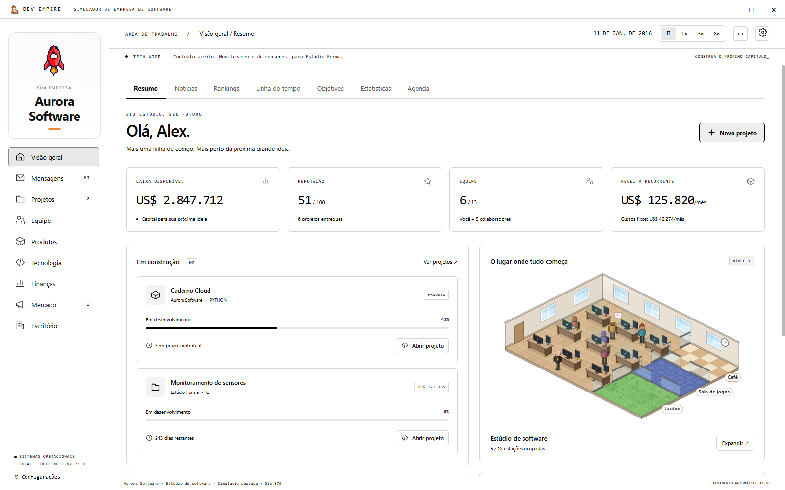](media/screenshots/02-visao-geral.png)

<table>
  <tr>
    <td width="50%" align="center"><strong>Jornal e notícias</strong></td>
    <td width="50%" align="center"><strong>Concorrência e mercado</strong></td>
  </tr>
  <tr>
    <td><a href="media/screenshots/11-noticias.png">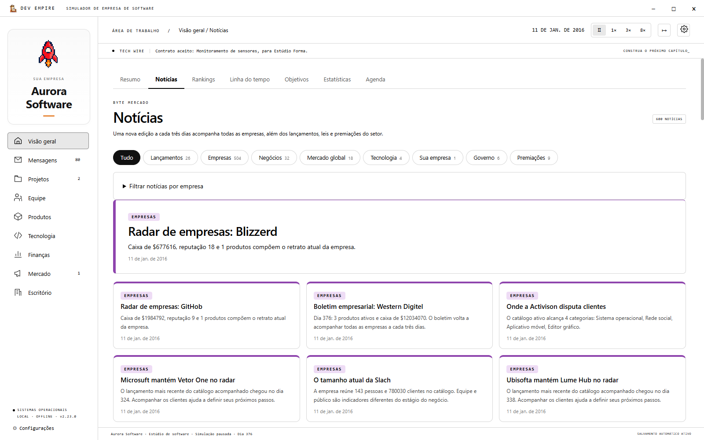</a></td>
    <td><a href="media/screenshots/10-concorrencia.png">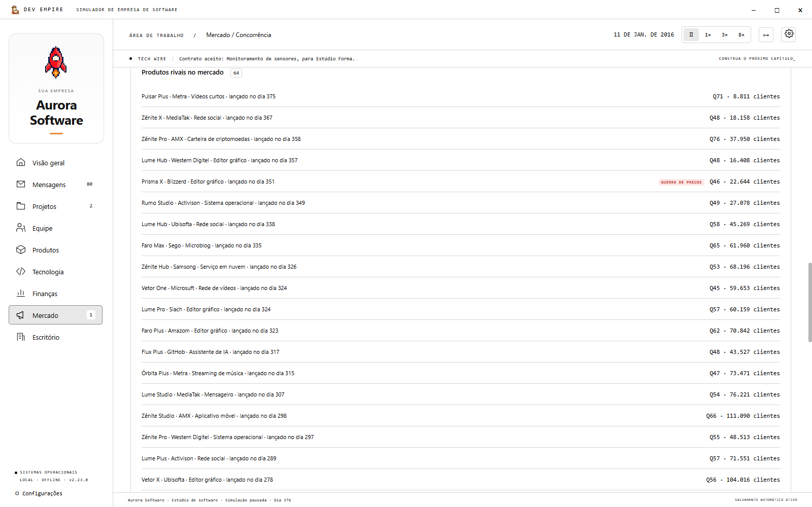</a></td>
  </tr>
  <tr>
    <td width="50%" align="center"><strong>Governo e regulação</strong></td>
    <td width="50%" align="center"><strong>Premiações anuais</strong></td>
  </tr>
  <tr>
    <td><a href="media/screenshots/12-governo.png">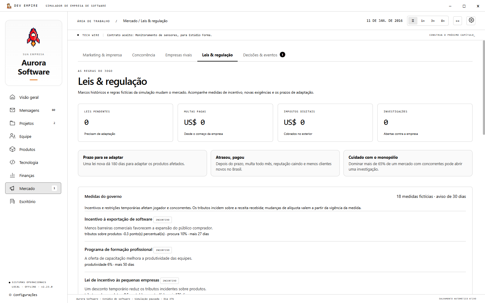</a></td>
    <td><a href="media/screenshots/13-premios.png">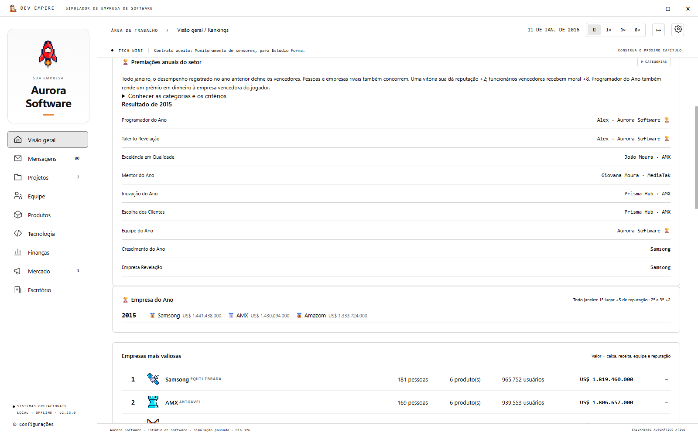</a></td>
  </tr>
  <tr>
    <td width="50%" align="center"><strong>Produtos próprios</strong></td>
    <td width="50%" align="center"><strong>Loja virtual</strong></td>
  </tr>
  <tr>
    <td><a href="media/screenshots/06-produtos.png">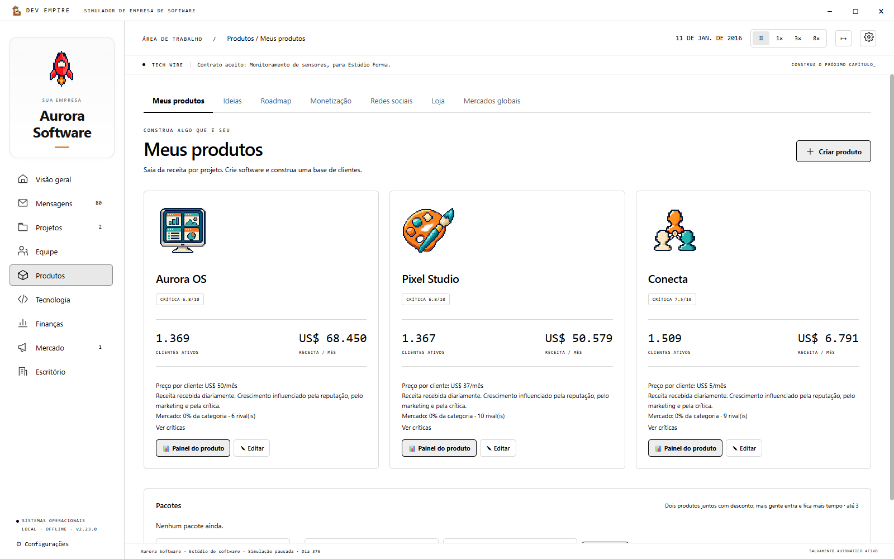</a></td>
    <td><a href="media/screenshots/08-plataformas.png">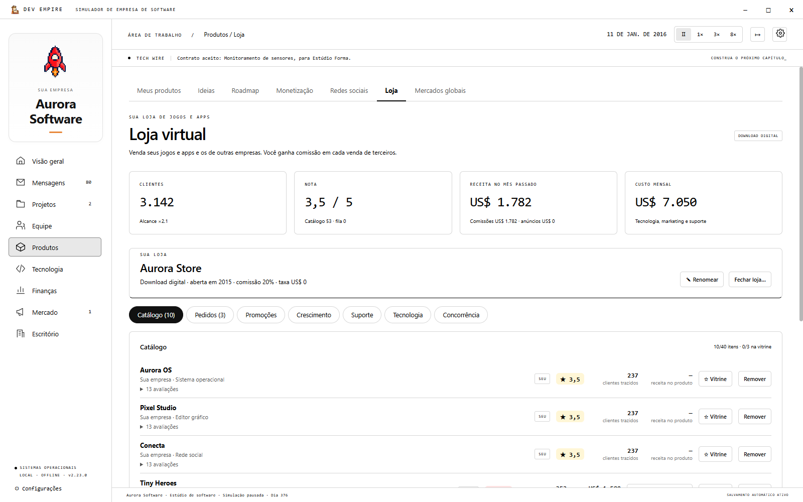</a></td>
  </tr>
  <tr>
    <td width="50%" align="center"><strong>Equipe e talentos</strong></td>
    <td width="50%" align="center"><strong>Desenvolvimento de projetos</strong></td>
  </tr>
  <tr>
    <td><a href="media/screenshots/04-equipe.png">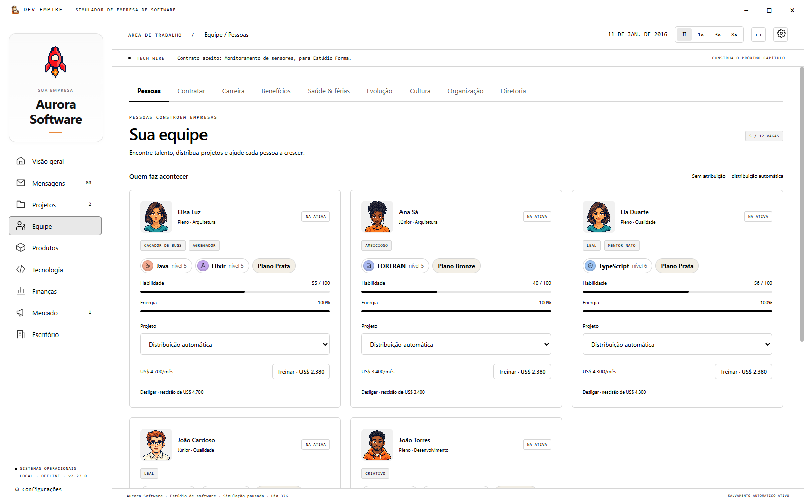</a></td>
    <td><a href="media/screenshots/03-projeto.png">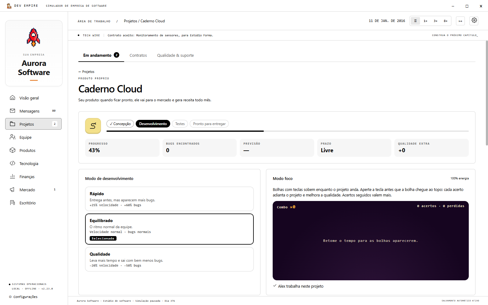</a></td>
  </tr>
  <tr>
    <td width="50%" align="center"><strong>Ambientes do escritório</strong></td>
    <td width="50%" align="center"><strong>Diretoria da empresa</strong></td>
  </tr>
  <tr>
    <td><a href="media/screenshots/14-ambientes.png">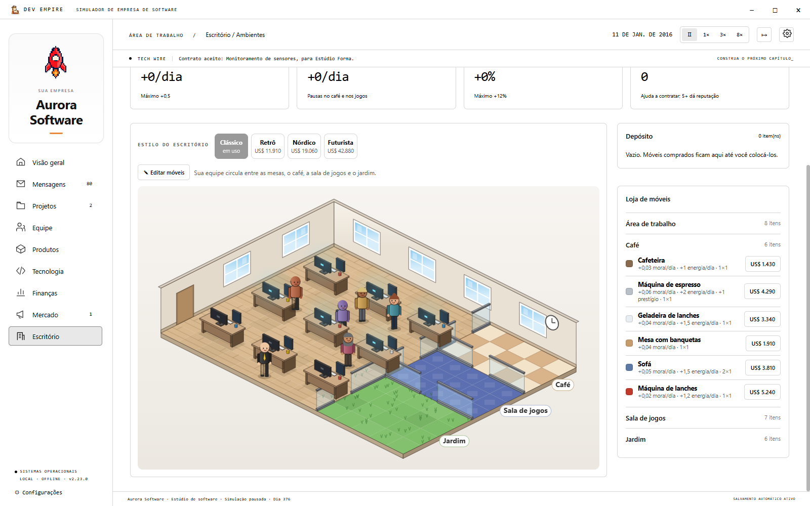</a></td>
    <td><a href="media/screenshots/07-diretoria.png">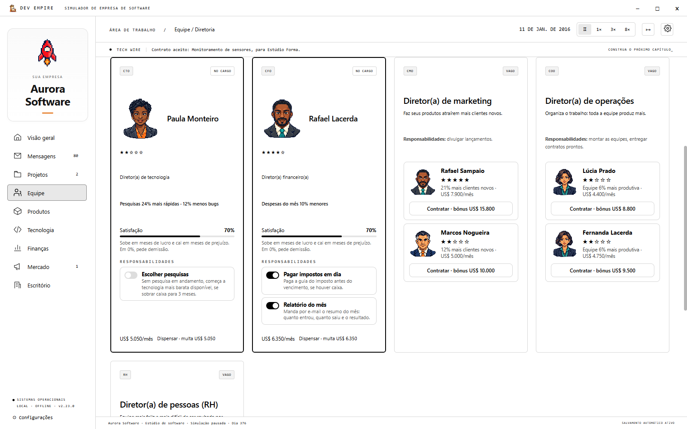</a></td>
  </tr>
  <tr>
    <td width="50%" align="center"><strong>Negociação de aquisições</strong></td>
    <td width="50%" align="center"><strong>Pesquisa e tecnologias</strong></td>
  </tr>
  <tr>
    <td><a href="media/screenshots/09-aquisicoes.png">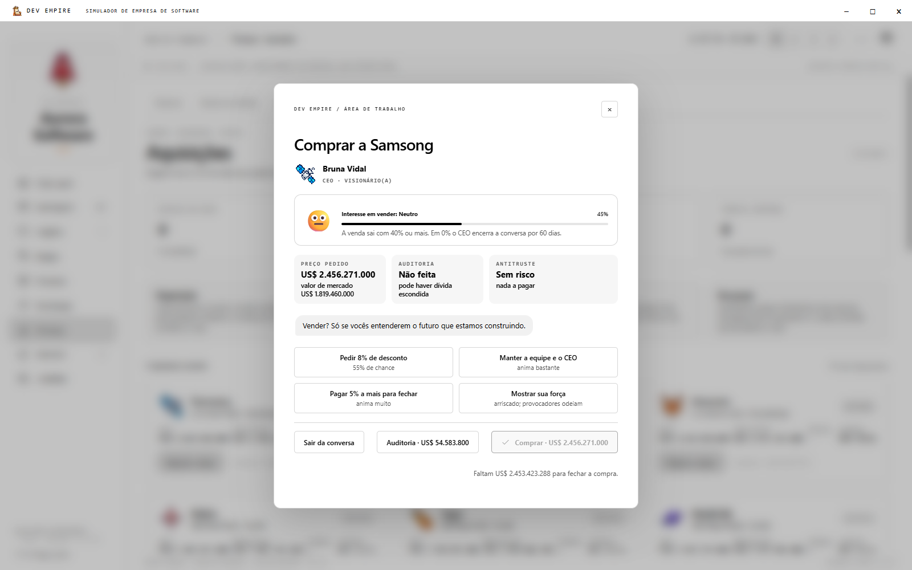</a></td>
    <td><a href="media/screenshots/05-tecnologias.png">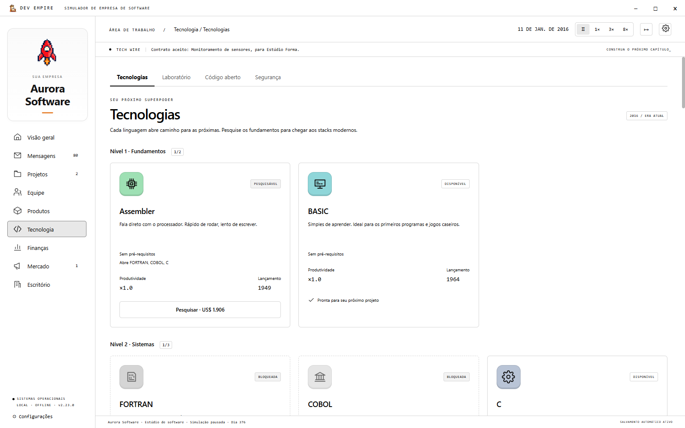</a></td>
  </tr>
</table>

<strong>Ver o menu principal</strong>

[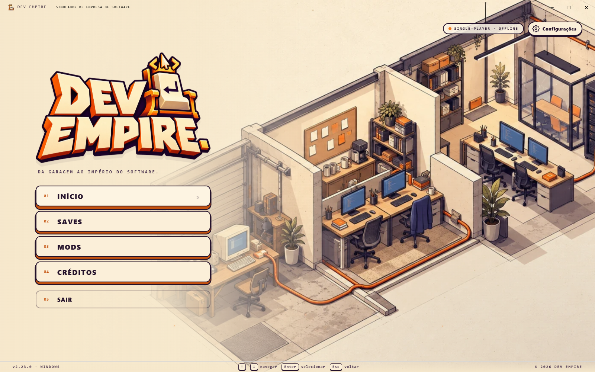](media/screenshots/01-menu.png)

## Como jogar

1. **[Baixe o jogo para Windows](https://github.com/ithalov/dev-empire/releases/download/v2.23.0/Dev-Empire-2.23.0-Windows.exe).**
2. Abra **Dev-Empire-2.23.0-Windows.exe**. A versão é portátil e não precisa de instalação.
3. Crie sua empresa e siga o guia do fundador para começar.

| Informação | Versão atual |
|---|---|
| Plataforma | Windows x64 |
| Idiomas | Português, inglês, espanhol, francês, alemão, chinês simplificado e japonês |
| Experiência | Single-player e offline |
| Download | Aproximadamente 126 MB |
| Progresso | Salvamento automático local e exportação/importação de saves |
| Fase | **BETA — em desenvolvimento** |

As traduções adicionais continuam em revisão durante o BETA.

**Já está jogando uma versão anterior?** Exporte seu save nas configurações antes de atualizar e feche o jogo antigo.

<strong>Dúvidas sobre o download</strong>

**Preciso instalar outros programas?** Não. O executável inclui o necessário para jogar.

**Preciso de internet para jogar?** Não. A partida e os saves funcionam offline.

**O Windows mostrou um aviso de editor desconhecido.** A BETA ainda não possui assinatura digital de editor. Baixe sempre pela página oficial deste repositório. O checksum SHA-256 está disponível na página da versão para conferir o arquivo.

**Qual arquivo devo baixar na página da versão?** O arquivo **.exe**. Os arquivos automáticos chamados **Source code** são arquivos da página de apresentação e não servem para jogar.

## Sobre o BETA

**Você está jogando uma versão em desenvolvimento.** O jogo já está disponível para experimentar, mas pode apresentar bugs e receber mudanças na interface, no conteúdo e no balanceamento.

Novas versões serão publicadas em **[Releases](https://github.com/ithalov/dev-empire/releases)**. Faça uma cópia do seu save antes de atualizar.

## Conte como foi sua experiência

Encontrou um bug ou pensou em algo que deixaria o jogo melhor? **[Envie seu feedback](https://github.com/ithalov/dev-empire/issues/new)**.

Ao relatar um problema, informe a versão do jogo, o que aconteceu e os passos para reproduzir. Uma captura de tela ajuda bastante.

---

<strong>Sua próxima grande ideia começa com o primeiro projeto.</strong> <a href="https://github.com/ithalov/dev-empire/releases/download/v2.23.0/Dev-Empire-2.23.0-Windows.exe">Baixe a BETA e funde sua empresa.</a>

