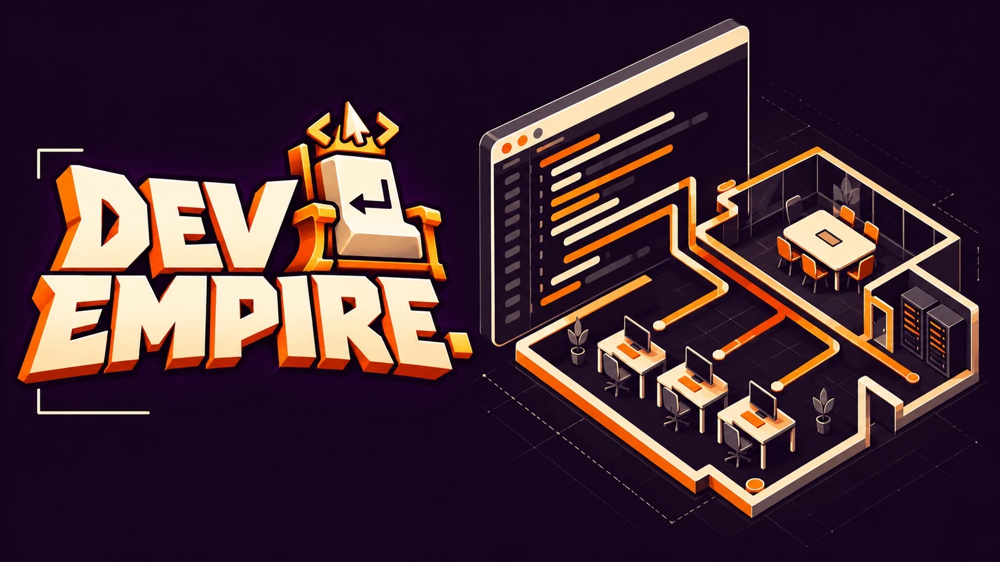
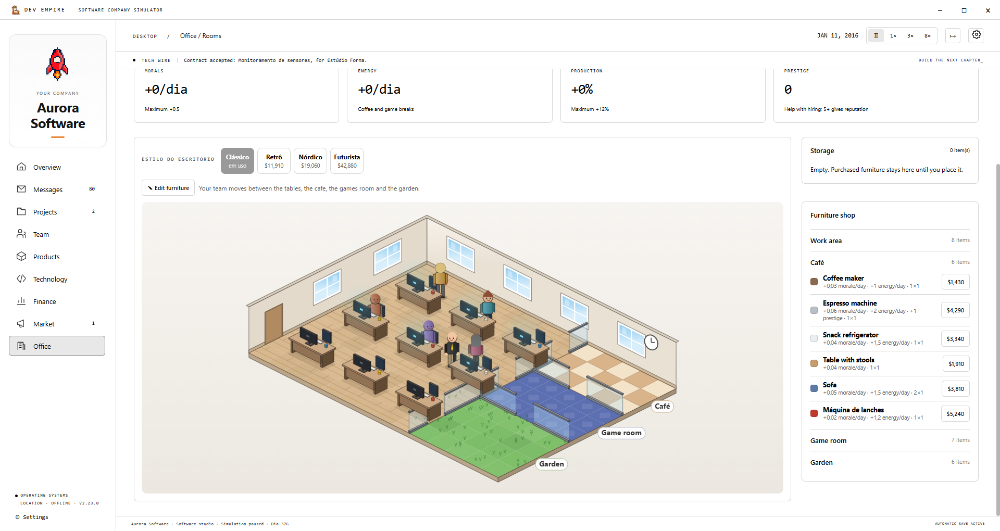
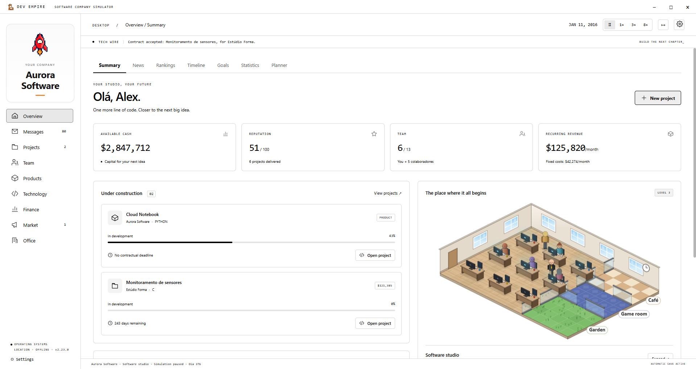
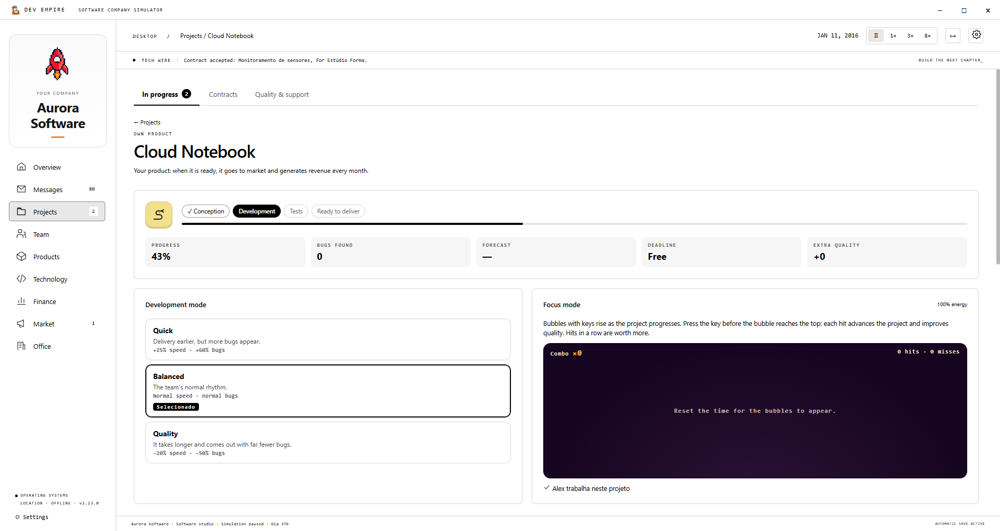

  

<h1 align="center">Dev Empire</h1>

<strong>Start with an idea. Build a company. Make your mark.</strong> A software company tycoon, made in Brazil for players around the world.

  
  
  
  
  

  

  <a href="#the-game">The game</a> · <a href="#a-small-look-inside">Preview</a> · <a href="#languages">Languages</a> · <a href="#start-playing">Start playing</a> · <a href="https://github.com/ithalov/dev-empire/releases">Updates</a>

---

## The game

A small workspace. Your first client. An idea that could become something bigger.

**Dev Empire** is a single-player software company management game. Take on contracts, bring talented people together and turn your ideas into products. Decide what to build, how to grow and when to take a risk as the industry changes around you.

Pause to plan, speed up to see the results, and find your own way forward. The founder's guide helps you get started; the decisions that follow are yours.

- **Create software:** choose technologies, manage development and bring products to market.
- **Build a team:** hire people, develop their skills and look after the workplace.
- **Grow your company:** shape your office, manage your finances and explore new opportunities.
- **React to a changing world:** customers, competitors and unexpected events keep your plans moving.
- **Make it your own:** explore local content mods and different ways to run your business.

## A small look inside

A glimpse of your future workspace. The rest is yours to discover.

<strong>Take a closer look — two more gameplay previews</strong>

**Your company, at a glance**

**From idea to development**

Actual Windows Beta 2.23.0 screenshots, using a demonstration company with the interface set to English. Click an image to enlarge it.

## Made in Brazil, open to the world

Dev Empire is an independent Brazilian project by **[ithalov](https://github.com/ithalov)**. Its roots are Brazilian, and its audience is international. Players discovering management games for the first time and longtime tycoon fans are both welcome.

Your feedback helps shape the game as it grows.

## Languages

Play in **English, Brazilian Portuguese, Spanish, French, German, Simplified Chinese or Japanese**. Brazilian Portuguese is the original language.

Choose your language in **Settings → Language**. English and the other additional translations are being refined during the beta, so some wording may still need polish.

## Start playing

1. **[Download the Windows executable](https://github.com/ithalov/dev-empire/releases/download/v2.23.0/Dev-Empire-2.23.0-Windows.exe).**
2. Open **Dev-Empire-2.23.0-Windows.exe**. This is a portable build; no separate runtime installation is needed.
3. Found your company and follow the founder's guide.

| Game details | Current beta |
|---|---|
| Platform | Windows x64 |
| Experience | Single-player · offline |
| Download | Approximately 126 MB |
| Progress | Local autosaves and save import/export |
| Current release | **Beta 2.23.0** |

**Updating from an earlier build:** export a backup of your save in Settings and close the old game before opening the new executable.

<strong>Download notes</strong>

- The beta executable is not digitally signed yet. Download it from this repository's official release pages. **SHA256SUMS.txt** is included with the release to verify the file.
- Choose the **.exe** under release assets. GitHub's automatic **Source code** archives contain this public presentation, not a playable build.
- Internet is needed to download the game. Your single-player game and saves work offline.

## Growing through beta

Dev Empire is in active development. Bugs may occur, and updates can change content, balance and the interface.

**Beta 2.23.0** makes the business world more active, expands company news and adds new economic events and annual recognition. Explore it at your own pace, or read the **[release notes](https://github.com/ithalov/dev-empire/releases/tag/v2.23.0)** for details.

## Help shape the next chapter

**[Report a bug or share an idea](https://github.com/ithalov/dev-empire/issues/new).** English and Brazilian Portuguese feedback are welcome. For a bug report, include your game version, what happened and how to reproduce it. A screenshot can help.

---

<strong>Made in Brazil. Built for your next big idea.</strong> <a href="https://github.com/ithalov/dev-empire/releases/download/v2.23.0/Dev-Empire-2.23.0-Windows.exe">Start your company.</a>

